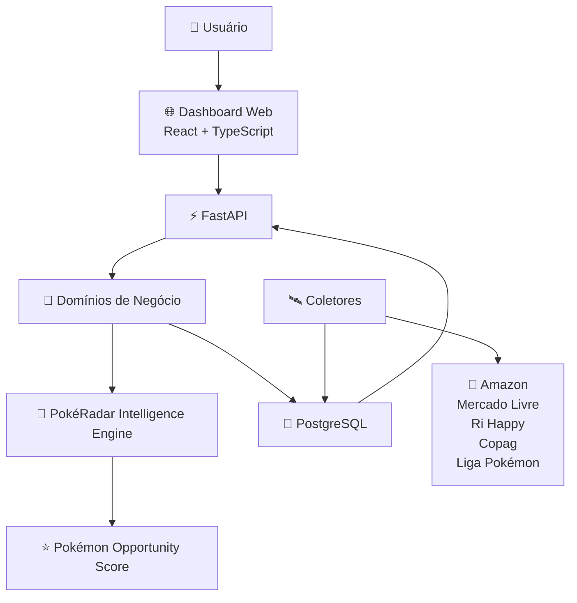
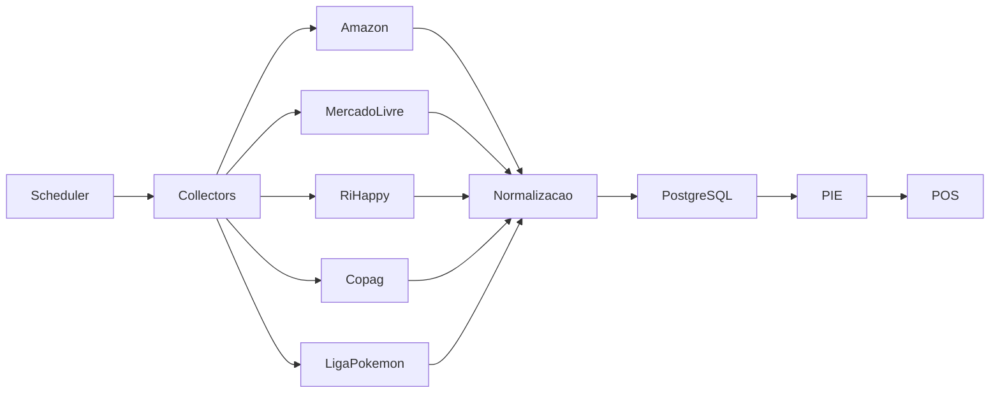
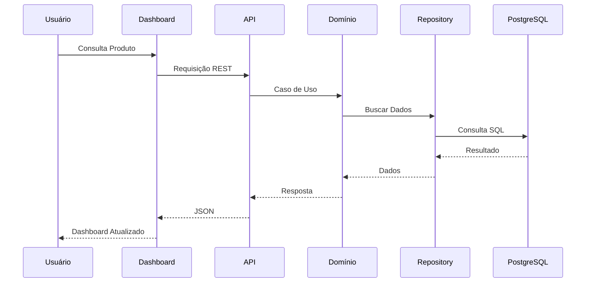

# PokéRadar - System Overview

**Projeto:** PokéRadar
**Documento:** Visão Geral do Sistema (System Overview)
**Versão:** 1.0.0
**Autor(es):** Jonnathan Henrique e ChatGPT (OpenAI)
**Data de criação:** 23/07/2026
**Última atualização:** 23/07/2026
**Status:** Em elaboração

---

# Histórico de Alterações

| Versão | Data       | Autor                        | Alteração                    |
| ------ | ---------- | ---------------------------- | ---------------------------- |
| 1.0.0  | 23/07/2026 | Jonnathan Henrique e ChatGPT | Criação inicial do documento |

---

# Sumário

1. Objetivo
2. Visão Geral da Plataforma
3. Arquitetura Geral
4. Fluxo de Coleta
5. Fluxo de Consulta
6. Módulos do Sistema
7. Evolução da Plataforma
8. Considerações Finais

---

# 1. Objetivo

Apresentar uma visão de alto nível da arquitetura do PokéRadar, demonstrando como seus principais módulos se relacionam e como os dados percorrem o sistema.

Este documento serve como ponto de partida para qualquer pessoa que deseje compreender rapidamente o funcionamento da plataforma.

---

# 2. Visão Geral da Plataforma

O PokéRadar é composto por quatro grandes áreas:

* Interface Web (Dashboard)
* Backend (API e Domínios)
* Motor de Inteligência (PIE)
* Persistência e Coleta de Dados

Essas áreas trabalham em conjunto para transformar dados coletados de diversas lojas em informações úteis para o usuário.

---

# 3. Arquitetura Geral



---

# 4. Fluxo de Coleta

O processo de atualização dos preços seguirá o fluxo abaixo.



---

# 5. Fluxo de Consulta

Quando um usuário acessar a plataforma, o fluxo será:



---

# 6. Módulos do Sistema

A plataforma será composta pelos seguintes módulos.

| Módulo        | Responsabilidade             |
| ------------- | ---------------------------- |
| Dashboard     | Interface do usuário         |
| API           | Exposição dos serviços REST  |
| Collectors    | Coleta de dados das lojas    |
| Database      | Persistência das informações |
| PIE           | Motor de inteligência        |
| POS           | Cálculo das oportunidades    |
| Scheduler     | Agendamento das coletas      |
| Notifications | Alertas (versões futuras)    |

---

# 7. Evolução da Plataforma

A arquitetura foi planejada para crescer de forma modular.

```text
PokéRadar

├── Dashboard
├── API
├── Collectors
├── Database
├── PIE
├── POS
├── Notifications
├── Portfolio
└── AI
```

Os módulos futuros poderão ser adicionados sem necessidade de reestruturar toda a plataforma.

---

# 8. Considerações Finais

Este documento apresenta uma visão arquitetural de alto nível do PokéRadar.

Os diagramas aqui apresentados deverão ser mantidos atualizados conforme novos módulos forem incorporados, garantindo que a documentação reflita sempre a arquitetura real da plataforma.
