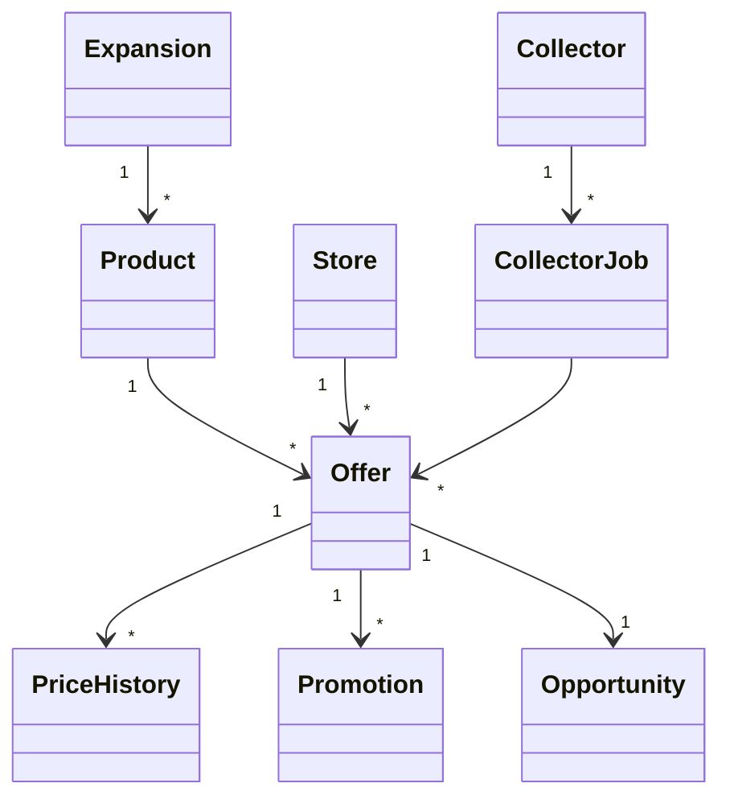

# PokéRadar - Domain Model

**Projeto:** PokéRadar
**Documento:** Domain Model (Modelo de Domínio)
**Versão:** 1.0.0
**Autor(es):** Jonnathan Henrique e ChatGPT (OpenAI)
**Data de criação:** 23/07/2026
**Última atualização:** 23/07/2026
**Status:** Em elaboração

---

# Histórico de Alterações

| Versão | Data       | Autor                        | Alteração                            |
| ------ | ---------- | ---------------------------- | ------------------------------------ |
| 1.0.0  | 23/07/2026 | Jonnathan Henrique e ChatGPT | Criação inicial do modelo de domínio |

---

# Sumário

1. Objetivo
2. Visão Geral
3. Entidades do Domínio
4. Relacionamentos
5. Diagrama do Domínio
6. Responsabilidades
7. Regras de Negócio
8. Evolução do Modelo

---

# 1. Objetivo

Este documento define o modelo de domínio do PokéRadar.

O foco deste documento é representar os conceitos do negócio e suas relações, independentemente da tecnologia utilizada para implementação.

Este modelo servirá de base para:

* Modelagem do banco de dados;
* Desenvolvimento da API;
* Implementação do backend;
* Construção do PIE (PokéRadar Intelligence Engine);
* Evolução futura da plataforma.

---

# 2. Visão Geral

O domínio do PokéRadar é composto pelos seguintes conceitos principais:

* Produto
* Expansão
* Loja
* Oferta
* Histórico de Preços
* Promoção
* Oportunidade
* Coletor
* Execução de Coleta

Cada conceito representa uma responsabilidade específica dentro da plataforma.

---

# 3. Entidades do Domínio

## Product

Representa um produto oficial monitorado pelo PokéRadar.

Exemplos:

* Booster Box
* Elite Trainer Box (ETB)
* Mini Box
* Blister
* Coleção Premium
* Coleção Parceiro Inicial

Um produto é único dentro da plataforma.

---

## Expansion

Representa a coleção ou expansão à qual um produto pertence.

Exemplos:

* Escarlate e Violeta
* Evoluções Prismáticas
* Caos Ascendente
* Rivais Predestinados

Uma expansão pode possuir diversos produtos.

---

## Store

Representa uma loja monitorada.

Exemplos:

* Amazon
* Mercado Livre
* Ri Happy
* Copag Store
* Liga Pokémon

Uma loja possui diversas ofertas.

---

## Offer

Representa uma oferta de venda de um produto em determinada loja.

A oferta possui informações como:

* preço atual;
* URL;
* disponibilidade;
* vendedor;
* condição do produto;
* data da última atualização.

Um mesmo produto poderá possuir diversas ofertas simultaneamente.

---

## Price History

Registra todas as alterações de preço de uma oferta.

Nunca será sobrescrito.

O histórico será permanente.

---

## Promotion

Representa uma promoção identificada automaticamente pelo PIE.

Nem toda redução de preço será considerada uma promoção.

A classificação dependerá das regras definidas pelo motor de inteligência.

---

## Opportunity

Representa o resultado da análise do PIE.

Contém:

* POS (Pokémon Opportunity Score)
* recomendação;
* justificativa;
* indicadores utilizados.

---

## Collector

Representa um módulo responsável pela coleta de dados de uma loja específica.

Cada loja possuirá seu próprio coletor.

---

## Collector Job

Representa uma execução de coleta.

Armazena:

* horário de início;
* horário de término;
* duração;
* quantidade de registros;
* erros encontrados;
* status da execução.

---

# 4. Relacionamentos

As principais relações do domínio são:

* Uma Expansão possui vários Produtos.
* Um Produto possui várias Ofertas.
* Uma Loja possui várias Ofertas.
* Uma Oferta possui vários registros de Histórico de Preços.
* Uma Oferta pode gerar diversas Promoções.
* Uma Oferta pode possuir uma Oportunidade vigente.
* Um Coletor executa diversas Coletas.
* Uma Coleta atualiza diversas Ofertas.

---

# 5. Diagrama do Domínio

---

# 6. Responsabilidades

| Entidade      | Responsabilidade                  |
| ------------- | --------------------------------- |
| Expansion     | Organizar produtos por coleção    |
| Product       | Representar um item monitorado    |
| Store         | Representar uma loja              |
| Offer         | Representar uma oferta comercial  |
| Price History | Registrar evolução dos preços     |
| Promotion     | Registrar promoções detectadas    |
| Opportunity   | Armazenar o resultado do PIE      |
| Collector     | Coletar dados das lojas           |
| Collector Job | Registrar execuções dos coletores |

---

# 7. Regras de Negócio

## RN-001

Um Produto poderá existir em diversas lojas simultaneamente.

---

## RN-002

Cada Oferta pertence a exatamente uma Loja.

---

## RN-003

Uma Oferta sempre estará associada a um Produto.

---

## RN-004

Todo preço coletado deverá ser armazenado no histórico.

Nenhuma atualização substituirá registros anteriores.

---

## RN-005

O PIE utilizará exclusivamente o histórico de preços para calcular o POS.

---

## RN-006

Promoções serão detectadas pelo PIE e não pelos coletores.

---

## RN-007

Coletores apenas coletam e normalizam dados.

Eles não executam regras de negócio.

---

# 8. Evolução do Modelo

O domínio foi projetado para permitir futuras expansões, incluindo:

* Usuários;
* Favoritos;
* Coleções pessoais;
* Portfólio de investimento;
* Notificações;
* Inteligência Artificial;
* Marketplace;
* API pública.

Essas funcionalidades poderão ser adicionadas sem alterar significativamente os conceitos centrais apresentados neste documento.

---

# Considerações Finais

O Modelo de Domínio é a principal representação do negócio do PokéRadar.

Toda implementação técnica deverá respeitar os conceitos definidos neste documento, garantindo que a evolução da plataforma permaneça alinhada ao seu propósito: transformar dados do mercado de Pokémon TCG em inteligência para tomada de decisão.
